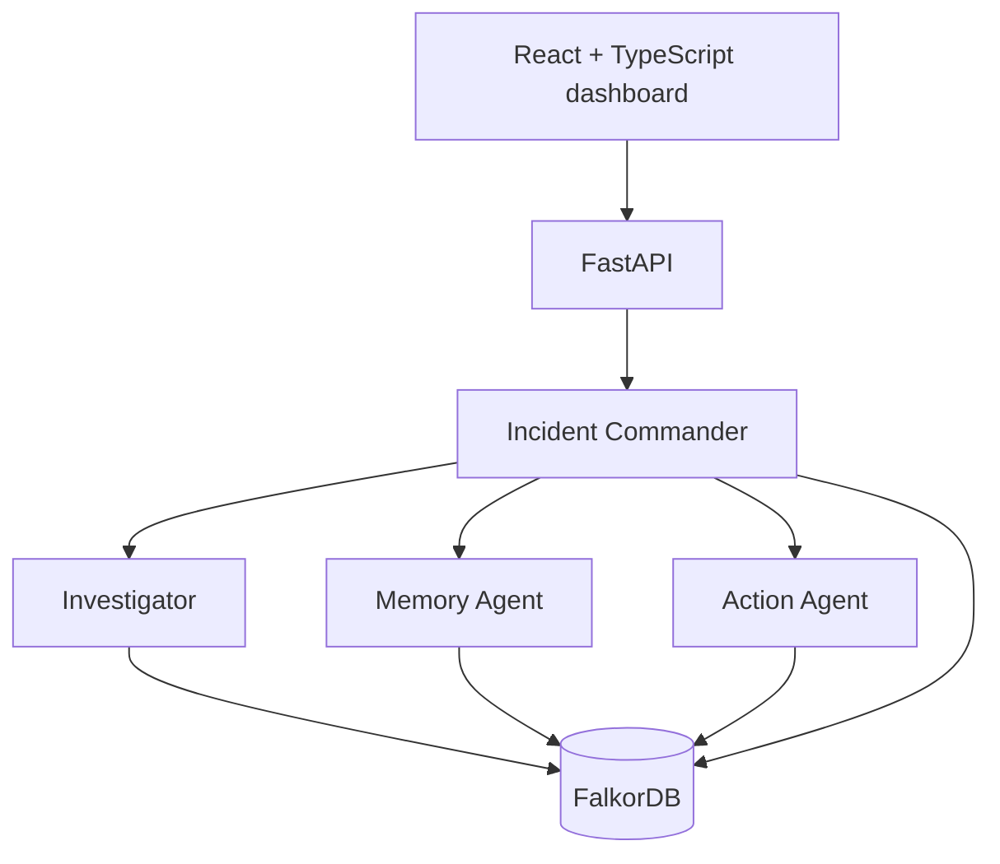

# TraceMind — Graph-First Incident Intelligence

TraceMind is an explainable, multi-agent engineering incident intelligence system. It uses **FalkorDB as the load-bearing context graph** to connect incidents, services, deployments, commits, tickets, technical decisions, service owners, and previous resolutions.

It is built for the “Agents That Act on Connected Data”, “Agent Memory and Coordination”, and “Company Brain” hackathon tracks.

## Why TraceMind

During a production incident, the important answer rarely lives in one ticket, dashboard, or chat message. TraceMind follows factual relationships stored in FalkorDB and returns the path that supports its recommendation.

For the flagship scenario, it retrieves:

```text
INC-104
  → checkout-service
  → DEP-184
  → a91f2
  → PAY-432
  → DEC-91
  → payment-api

INC-071 → RES-17 → restore timeout to 5 seconds
```

The recommendation is not prewritten on the incident. It is derived from the connected deployment/code/decision graph and the historical resolution precedent.

## Features

- FalkorDB-backed Cypher traversal for multi-hop incident investigation.
- Four distinct agent responsibilities: Incident Commander, Investigator, Memory Agent, and Action Agent.
- Persistent, tenant-scoped memory records in FalkorDB.
- Graph-persisted investigations, agent runs, handoffs, findings, and proposed actions.
- Explainable `EvidencePath` responses containing factual nodes and relationships—not private chain-of-thought.
- Approval-gated simulated actions. TraceMind never performs infrastructure changes.
- Responsive internal engineering-operations dashboard.
- Deterministic seeded data; no paid LLM or API key required.

## Architecture



### Agent responsibilities

| Agent | Responsibility | Graph work |
|---|---|---|
| Incident Commander | Creates and closes investigations | Persists investigation and handoff state |
| Investigator | Finds technical cause candidates | Traverses incident → deployment → commit → ticket → decision |
| Memory Agent | Finds prior relevant outcomes | Retrieves related incidents, resolutions, and tenant memory |
| Action Agent | Recommends a safe response | Creates a `PROPOSED` simulated action from current + historical evidence |

## Quick start with Docker — recommended

Prerequisite: Docker Desktop or Docker Engine with Docker Compose v2.

```bash
git clone https://github.com/DhananjayCodes/TraceMind.git
cd TraceMind
docker compose up --build
```

Open:

- Dashboard: http://localhost:5173
- API documentation: http://localhost:8000/docs
- Health: http://localhost:8000/health
- Graph health: http://localhost:8000/api/graph/health

The first start downloads the FalkorDB image and seeds the graph once. Subsequent starts preserve the FalkorDB volume and stored memories.

To stop services:

```bash
docker compose down
```

To remove all persistent demo data and start fresh:

```bash
docker compose down -v
docker compose up --build
```

## Local development

### Backend

```bash
python3 -m venv .venv
. .venv/bin/activate
pip install -r backend/requirements.txt
```

For the full graph-backed backend, start FalkorDB through Docker and run:

```bash
TRACEMIND_GRAPH_PROVIDER=falkor \
FALKORDB_URL=redis://localhost:6379 \
PYTHONPATH=. uvicorn backend.app.main:app --reload
```

For a no-Docker deterministic development mode, omit `TRACEMIND_GRAPH_PROVIDER=falkor`. This mode uses the local compatibility graph only; Docker Compose always uses FalkorDB.

### Frontend

```bash
cd frontend
npm install
npm run dev
```

Open the URL printed by Vite, usually http://localhost:5173.

## Demo script

The dashboard path:

1. Open **Overview**.
2. Select **Investigate with TraceMind** for `INC-104`.
3. Review the proposed safe action and the responsible team.
4. Click **Show Evidence Path**.
5. Explain that the history from `INC-071` and `RES-17` alters the Action Agent’s recommendation.

The CLI showcase:

```bash
PYTHONPATH=. python scripts/demo.py
```

## API examples

Start an investigation:

```bash
curl -X POST http://localhost:8000/api/investigations \
  -H 'Content-Type: application/json' \
  -d '{"incident_id":"INC-104","tenant_id":"demo"}'
```

Inspect tenant-scoped memory:

```bash
curl 'http://localhost:8000/api/memories?tenant_id=demo'
```

## Testing

```bash
PYTHONPATH=. pytest backend/tests -q
cd frontend && npm run build
```

Current automated tests cover seed idempotency, evidence generation, memory persistence, tenant isolation, API health, main investigation API behavior, and action safety.

## Graph model

Core nodes: `Incident`, `Service`, `Deployment`, `Commit`, `Ticket`, `Decision`, `Resolution`, `Team`, `Person`, `Investigation`, `AgentRun`, `Action`, and `Memory`.

Core relationships: `AFFECTS`, `DEPENDS_ON`, `STARTED_AFTER`, `CONTAINS`, `IMPLEMENTS`, `RESULTED_IN`, `CHANGED`, `RESOLVED_BY`, `APPLIED_TO`, `OWNED_BY`, `MAINTAINS`, `PRODUCED`, `HANDOFF_TO`, `DERIVED_FROM`, `REMEMBERS`, and `PROPOSED`.

See [docs/graph-schema.md](docs/graph-schema.md) and [docs/architecture.md](docs/architecture.md) for diagrams and implementation detail.

## Why a graph instead of vector search alone?

Vector search is excellent at finding semantically similar documents. It cannot reliably prove that a specific deployment contained a commit that implemented a ticket, which led to a decision that changed a dependent service. TraceMind uses Cypher relationship traversal for those facts, then returns the exact factual graph evidence used by its agents.

## Safety and limitations

- Recommendations are simulated and approval-gated; no deployment, restart, rollback, or configuration mutation is performed.
- Demo data is deterministic and synthetic.
- The current graph is seeded locally; production integrations with GitHub, Linear, observability, and documentation systems are planned extension points.

## Useful Make commands

```bash
make up      # build and start containers
make down    # stop containers
make test    # run backend tests
make seed    # run deterministic CLI demo
make logs    # follow Compose logs
```

## License

MIT. See [LICENSE](LICENSE).
# TraceMind
