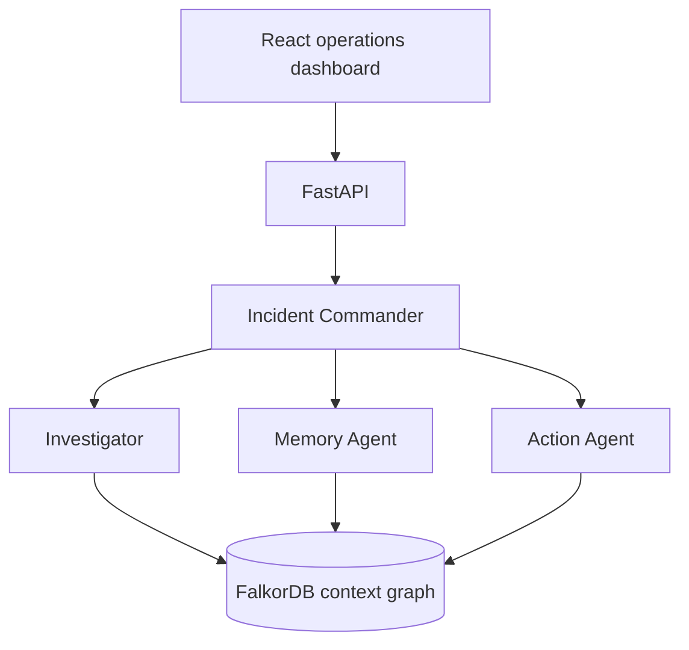

# Architecture

The commander persists investigation state. Investigator follows deployment/code relationships, Memory Agent follows precedent/resolution relationships, and Action Agent only proposes approval-gated simulations.
