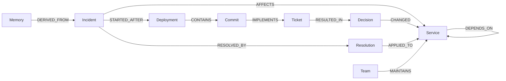

# Graph schema

Nodes include Incident, Service, Deployment, Commit, Ticket, Decision, Resolution, Team, Person, Investigation, Finding, AgentRun, Action and Memory. Edge metadata can include source, timestamp, confidence, reason and status.
